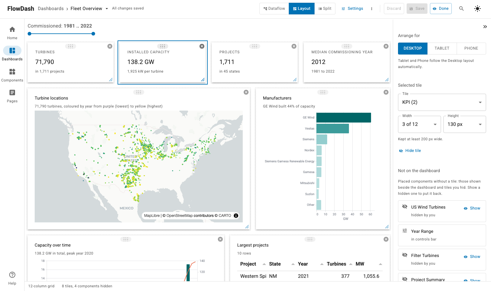

# Layout & Sizing

Once components are wired together, the editor has two views of the same set of
nodes:

- **Dataflow** (`mode="wiring"`) - the ReactFlow canvas where you add
  components and connect ports.
- **Layout** (`mode="dashboard"`) - a responsive tile grid that renders each
  component's live view, the layout your users actually see.

Switch between them with the *Dataflow* and *Layout* tabs in the dashboard bar
while editing. To see the dashboard exactly as it will appear when served, press
*Done* (or choose *View*): view mode is the preview.



The slider above the tiles is a component marked `sidebar=True`, shown in the
controls bar as described [below](#sidebar-components).

## Arranging tiles

In the *Layout* tab every tile has a dashed frame, a drag handle at the top
and a resize grip in its bottom-right corner. Drag a tile by its handle to
move it, and drag the grip to resize it.

Clicking, dragging or resizing a tile selects it, with an outline in the
primary color, and selects its component on the *Dataflow* canvas too;
selecting a component on the canvas selects its tile in turn. The selection
carries over between the *Dataflow*, *Layout* and *Split* tabs, and is not a
change to save.

The sidecar on the right is the same panel as in the *Dataflow* and *Split*
tabs. Click a tile and it shows that component's tabs, opening on **Tile**;
*Settings*, *Data* and, for a node the assistant made, *History* are a click
away. With nothing selected it shows the dashboard:

- **Arrange for** picks the screen size you arrange the tiles for: *Desktop*,
  *Tablet* or *Phone*, one per band of the grid's `breakpoints` (see
  [Responsive layouts](#responsive-layouts)). It starts at the band of the
  main layout, usually *Desktop*. Under it the panel says which sizes follow
  the main layout automatically and which were arranged separately, and
  **Reset to automatic** discards the separate arrangement of the size shown.
- **Not on the dashboard** lists the placed components that have no tile and
  why: *in top bar* or *in sidebar* for components shown beside the grid (*in
  sidebar* when `controls_bar` is off), with a **Move to grid** action, and
  *hidden* for tiles you hid and for the tiles of sources and transforms the
  agent added, with a **Show** action that puts the tile back.

The **Tile** tab sets the tile's **Width** in columns of the 12-column grid
(*Half (6/12)*, *Quarter (3/12)* and so on) and its **Height** in pixels, or
*Automatic* to size it to its content; the heights offered stay within the
component's `min_size` and `max_size`. **Frame** draws the tile as a card in
view mode or not, or leaves it to the default, which names what it resolves to
(see [Tile frames](#tile-frames)). **Show on dashboard** takes the tile off the
dashboard without removing the component from the dataflow, or puts it back.

The status bar under the grid summarizes it, e.g. "12-column grid, 4 tiles,
2 components hidden". Changes made in the sidecar edit the authored layout (see
[Responsive layouts](#responsive-layouts)) and, like dragging, mark the
dashboard as having unsaved changes. Fold the sidecar with its arrow button to
give the grid more room, and drag its left edge to make it wider or narrower
(between 300 and 560 px); the browser remembers the width.

### Automatic arrangement

**Arrange layout** in the command palette lays every visible tile out by its
kind: controls first, then KPIs, charts two to a row at their `default_size`
height, tables at full width, and the tiles of data sources and transforms
last. Controls, KPIs and data tiles keep the width of their `default_size` in
whole columns, e.g. 3 of 12 for a 280 px KPI. Controls and KPIs share a row
when they all fit in it; otherwise the KPIs start a row of their own. A chart
left on its own row takes at most twice its default width. Headings and other
text tiles stay in front of the tile that followed them, so a heading keeps
titling its section. The grid moves a tile up into any gap it fits, so the
room a row of controls and KPIs leaves is filled on purpose: by the leading
heading in the first row, else by the chart or table that follows, at its own
height, else by widening the row's tiles to at most twice their width when a
later tile would move into the room. Other tiles in a row share one height.
The layouts for narrower screens are generated from this one, and separate
arrangements made for other screen sizes are dropped. **Arrange dataflow**
does the same for the *Dataflow* canvas: sources on the left, views on the
right, in columns by their depth in the dataflow, ordered so fewer edges
cross, with groups of nodes that are not wired to each other side by side.
Each is one change.

Tiles and nodes the agent adds are laid out this way: a node the agent places
goes beside the nodes it is connected to and follows as it is wired, until you
move it, and the tiles a request adds are laid out once the request ends. The
tiles of the data sources and transforms it adds start hidden, since they are
the dashboard's plumbing; **Show** them under **Not on the dashboard**. While
no tile was arranged by hand the whole grid is arranged again; afterwards new
tiles are only added next to their kind. Arranging keeps every other setting
of a tile's layout entry. The rules and spacing live in
`panel_flowdash.auto_layout`.

---

## Sidebar components

Not every component belongs in the tile grid. Filters, data-source selectors,
and other controls often read better in a persistent sidebar. Mark such a
component with `sidebar=True`:

```python
@register(component=True, sidebar=True, title="Capacity Filter")
class app(pn.viewable.Viewer):
    min_capacity = param.Number(default=0, bounds=(0, 10000), step=100)

    @param.output(param.String)
    @param.depends("min_capacity")
    def filter_expr(self):
        return f"t_cap >= {self.min_capacity}" if self.min_capacity > 0 else ""

    def __panel__(self):
        return pmui.IntInput.from_param(self.param.min_capacity)
```

### Controls

In view mode and on the Layout tab, a `sidebar=True` component's view is rendered
as a control beside the tiles instead of in the tile grid. Where depends on
`controls_position`:

- `"top"` (the default) puts the controls in one slim row above the tiles that
  wraps on narrow screens. It suits the few filters most dashboards have and
  keeps the tiles close to the top of the page.
- `"left"` stacks them in a panel left of the tiles, which collapses to a narrow
  strip. It suits dashboards with many controls.

Material UI inputs among the controls switch to their small size, and nothing is
shown while the dashboard has no controls. Set the default with
`FlowDash(controls_position=...)` or `FlowDashApp(controls_position=...)` (also
readable from a project's `__init__.py`); each dashboard can override it with
the *Controls* choice in its settings, saved as the `controls_position` setting.

### Moving components beside the grid

On the Layout tab any control, KPI or text can sit in the top bar, in the
sidebar or on the grid, whatever its registration. Drag a tile by its handle
onto the top bar or the sidebar, which are outlined while you drag (an empty one
appears as a strip along the top or the left edge of the grid). Drag a
component beside the grid by the grip at its left back onto the grid, where it
goes in front of the tile under the pointer, or to another place in its bar.
Charts, tables and data previews stay on the grid: they need the room of a tile,
so their drop targets say so and refuse them. The **Move to grid**, **Move to
top bar** and **Move to sidebar** buttons in the sidecar's *Tile* tab and its
**Not on the dashboard** list do the same from the keyboard.

Each move is one edit in the history, so undo takes it back, and the dashboard
saves it as the tile's `area` (see [Dashboard YAML](../reference/dashboard-yaml.md#layout)).
A tile moved off the grid keeps its width and height for when it comes back.
Controls you never moved follow the `controls_position` setting.

The component still participates in the dataflow exactly like any other node,
its ports wire up the same way; only its placement changes. Pass
`controls_bar=False` (through `editor_options` for a `FlowDashApp`) to render
these views in the page sidebar instead. The pipeline, source to transforms to
views with a status dot per stage, is in the popover of the health chip next to
the dashboard's title.

The `complex_dataflow` example uses this for its data source and all three
filters, keeping the main grid for the table, chart, and map.

---

## Tile sizing hints

Components can declare their preferred size on the grid through `@register`:

```python
@register(
    component=True,
    default_size={"width": 600, "height": 400},
    min_size={"width": 300, "height": 200},
    max_size={"width": 1200, "height": 800},
)
class app(pn.viewable.Viewer):
    ...
```

Each hint is a dict with a `width`, a `height` or both, in pixels. Any other
key is ignored with a warning.

- `default_size` is the size a tile starts at when the dashboard has no layout
  entry for it, e.g. when it was just added. The layout stores widths as a
  percentage of the row, so the default width is converted at the grid's
  reference width (see [Responsive layouts](#responsive-layouts)): a 600px tile
  on a dashboard authored at 1200px takes half the row.
- `min_size` and `max_size` bound the tile while you resize it in dashboard
  mode, and apply to stored layouts when a dashboard is loaded, so a layout
  saved before the hints existed is brought within them. On narrower screens
  the minimum width still holds: a tile wraps onto a new line rather than
  shrinking below it.

Within these bounds the author can resize tiles freely, and the arrangement
they settle on is what gets persisted.

## Tile frames

In view mode a tile is drawn as a framed card or as the component's own view.
Three settings decide which, the first one set wins:

1. The tile's **Frame** option, in the sidecar's *Tile* tab: *Framed*, *Unframed* or *Default*. It is
   saved with the tile (`framed` in the [dashboard YAML](../reference/dashboard-yaml.md#layout)).
2. The component's `framed` hint in `@register`. Components that are layout
   chrome themselves set `framed=False`, like the built-in Divider and Heading,
   so a rule or a section title between charts is not boxed in a card.
3. The dashboard's `tile_cards` setting (**Frame tiles** in its settings),
   on by default.

```python
@register(component=True, framed=False)
class Banner(pn.viewable.Viewer):
    ...
```

While you arrange tiles the grid draws its own outline around every tile, so
the frame shows in view mode.

---

## Responsive layouts

Arrange the tiles once, at the width you are working at, and the grid adapts the arrangement to narrower screens. The grid records the width you arranged the tiles at as `reference_width`. On a narrower screen each tile may shrink to half its authored width; once it would shrink further, it wraps onto a new line instead. Tiles in a row that no longer fits are split into evenly balanced lines, and a tile alone on a line takes the full width. In the `complex_dataflow` example the chart and map share a row on a desktop and stack above the table on a laptop with both side panels open.

The grid's `breakpoints` divide the viewport into bands; the default `[768, 1200]` yields `xs` below 768px (*Phone*), `sm` between (*Tablet*), and `md` above 1200px (*Desktop*). With one breakpoint the bands are *Phone* and *Desktop*, with three a *Laptop* band comes between *Tablet* and *Desktop*, and with more the bands between *Phone* and *Desktop* are named by their widths. **Arrange for** in the Layout tab's panel picks the band the grid shows and edits:

- The band containing `reference_width` is the main layout. Editing it changes the authored layout, `tile_layout`, however narrow the grid is on your screen: the grid keeps the tiles' widths relative to the row and never mistakes a narrow editor for a tablet.
- Any other band is shown at a width inside it, framed, with the layout generated from the main one. Editing it saves a separate layout for that band in `responsive_layouts`, and **Reset to automatic** discards it again. Width and height set in the panel's **Selected tile** section always apply to the main layout.

The *Split* tab always arranges the main layout, fitted to the width of its
pane.

Custom layouts are stored in `responsive_layouts`, a mapping from band label to a list of tile entries. Each entry records a tile's index, width (as a percentage of the row), height in pixels, and visibility:

```json
{
  "xs": [
    {"index": 0, "width": 100, "height": 440, "visible": true},
    {"index": 1, "width": 100, "height": 450, "visible": true}
  ]
}
```

---

## What gets persisted

When you save a dashboard, the grid arrangement and responsive settings are stored alongside the nodes and edges:

- `tile_layout` - the authored arrangement.
- `reference_width` - the grid width in pixels the arrangement was authored at.
- `breakpoints` - the pixel thresholds in use.
- `responsive_layouts` - the custom per-band arrangements described above.

On load these are restored so the dashboard reopens with the same layout at every width. Dashboards saved before `reference_width` existed are treated as authored at the largest breakpoint. See [Persist dashboards](persist-dashboards.md) for the storage model and CRUD API.

---

## Related

- [Register components](register-components.md) - `sidebar`, `default_size`, `min_size`, `max_size`
- [Configure nodes](configure-nodes.md) - design-time configuration for each node
- [Persist dashboards](persist-dashboards.md) - how layouts are saved and loaded
