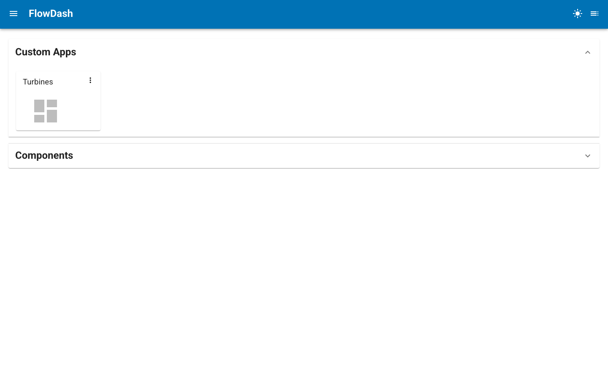

# Serve a Project

The `flowdash serve` command scans a project directory, discovers components
and pages, and launches a Panel server with all routes configured.

---

## Basic usage

```bash
flowdash serve my_project/
```

This:

1. Adds `my_project/` to `sys.path` (unless it is served with `--package`)
2. Scans subdirectories for modules with `@register`-decorated `app` exports
3. Builds the component registry and specs
4. Creates a `DashboardStore` at `my_project/dashboards.db`
5. Serves the app on `http://0.0.0.0:5006`

The landing page lists the saved dashboards you can open as cards, each with a
thumbnail of its tile layout, when it was last edited and by whom, and how it
is shared. Filter them to the ones you own or that are shared with you, sort
them by name or last edit, and switch between a grid and a list. Each card's
menu opens, edits, renames, duplicates, shares, downloads or deletes the
dashboard, offering only what your access allows. Below the dashboards are the
project's pages and its most used components. From here you can also start a
new dashboard or import a downloaded dashboard file.



---

## CLI options

```bash
flowdash serve <directory> [options]
```

| Option | Default | Description |
|--------|---------|-------------|
| `--port` | `5006` | Port to serve on. |
| `--address` | `0.0.0.0` | Address to bind to. |
| `--title` | `FlowDash` | Application title in the browser tab. |
| `--home-dashboard` | none | Dashboard (id or title) to show on the homepage instead of the grid. |
| `--nav-variant` | `rail` | How navigation is rendered: `rail`, `left`, `right` or `menubar`. See [Navigation](#navigation). |
| `--package` | none | Serve the project as this importable package, naming modules `<package>.<Section>.<name>` instead of adding the directory to `sys.path`. See [Serving a package](#serving-a-package). |
| `--db-path` | `<dir>/dashboards.db` | Path to the SQLite database. Conflicts with a `store` defined in the project. |
| `--warm` | off | Import all modules at startup instead of lazily on first visit. |
| `--dev` | off | Enable autoreload for development. |
| `--admin` | off | Enable the Panel admin interface. |
| `--profiler` | none | Profiler to use (pyinstrument, snakeviz). |
| `--num-threads` | auto | Thread pool size. |
| `--allow-websocket-origin` | all | Restrict allowed websocket origins. |
| `--no-notifications` | off | Disable Panel notifications. |
| `--static-dirs` | none | Serve extra static file directories, e.g. `--static-dirs assets=/path/to/assets`. Paths are resolved relative to the project directory. |
| `--plugins` | none | Register extra Tornado routes from an importable module exposing a `ROUTES` list, e.g. `--plugins my_plugin` for `<project>/my_plugin.py`. With `--package`, pass the dotted name, e.g. `--plugins catalogue.my_plugin`. Repeatable. |

`--title`, `--home-dashboard` and `--nav-variant` can also be set in the
project's `__init__.py` (see [Project configuration](#project-configuration)).
A flag given on the command line takes precedence over the module attribute.

`flowdash serve` is built on Panel's `serve` command and inherits its full
set of CLI options (OAuth, REST providers, session options, and more).
Run `flowdash serve --help` for the complete, up-to-date list.

---

## Development mode

```bash
flowdash serve my_project/ --dev --port 8080
```

With `--dev`, the server reloads automatically when source files change.

---

## Custom database location

By default, the dashboard database is created inside the project directory.
Override this for shared deployments:

```bash
flowdash serve my_project/ --db-path /var/data/flowdash.db
```

---

## Custom dashboard store

To keep dashboards somewhere other than SQLite, define `store` in the project's
`__init__.py`. It can be any `BaseDashboardStore`, such as a folder of JSON
files that lives with the project:

```python
# my_project/__init__.py
from pathlib import Path

from panel_flowdash import JSONFolderDashboardStore

store = JSONFolderDashboardStore(Path(__file__).parent / "dashboards")
```

See [Persist dashboards](persist-dashboards.md) for the available stores.
Passing `--db-path` as well is an error, since the two would disagree about
where dashboards live.

---

## Homepage dashboard

By default the homepage (`/`) shows the launcher listing the saved dashboards
and the project's pages. To land users directly on a specific dashboard
instead, pass `--home-dashboard` with either its id or its title:

```bash
flowdash serve my_project/ --home-dashboard "Sales Overview"
```

The dashboard is resolved by id first, then by title. Titles are only unique
per user, so a title prefers the current user's own dashboard, then the most
recently updated one they may open. Once dashboards with that title belong to
more than one user, the title is ambiguous: other users get the launcher grid
and an error is logged asking you to configure the dashboard by id, so that
nobody can replace the homepage by creating a dashboard with the same title.
Prefer an id whenever users can create dashboards. If it cannot be found, or
the current user is not authorized to view it, the homepage falls back to the
launcher grid. The grid remains reachable through the "Home" entry only when no
home dashboard is configured, so use this for deployments centered on a single
dashboard.

---

## Running as a module

You can also run FlowDash without the entry point script:

```bash
python -m panel_flowdash.command serve my_project/
```

---

## Lazy loading and warm start

By default, page and component modules are imported lazily — on the first visit
to that page or on first open of the component editor. This keeps startup fast
even when individual modules have heavy dependencies.

Pass `--warm` to import all modules at startup instead:

```bash
flowdash serve my_project/ --warm
```

Import errors are logged as warnings; they do not abort startup.

---

## Project initialization file

If `my_project/__init__.py` exists, it is executed during server startup,
before Panel launches. Use it for any
pre-configuration that the rest of the project depends on:

```python
# my_project/__init__.py
import os
import panel as pn

os.environ.setdefault("DATABASE_URL", "postgresql://localhost/mydb")

# Register Panel extensions needed by your components (e.g. tabulator, vega, deckgl).
# FlowDash only calls pn.extension() with notifications enabled by default,
# so any additional extensions must be loaded here.
pn.extension("tabulator", "vega", sizing_mode="stretch_width")
```

The file runs with `my_project/` already on `sys.path` and as the working
directory, so local relative imports work normally. A project served with
`--package` is imported as that package instead, see below.

---

## Project configuration

After executing `__init__.py`, `flowdash serve` reads the following module
attributes and passes them to `FlowDashApp`. All are optional, and a name that is
missing or set to `None` keeps its default.

| Name | Type | Description |
|------|------|-------------|
| `store` | `BaseDashboardStore` | Where dashboards are kept, see [Custom dashboard store](#custom-dashboard-store). Conflicts with `--db-path`. |
| `breakpoints` | `list` | Responsive breakpoints of the tile grid. Default `[768, 1200]`. |
| `configure_layout` | callable | Per-page sidebar and contextbar hook, see [Page-aware sidebar and contextbar](#page-aware-sidebar-and-contextbar). |
| `controls_position` | `str` | Where `sidebar=True` components go: `"top"` (default) in a row above the tiles or `"left"` in a collapsible panel, see [Layout & sizing](layout-and-sizing.md#controls). Dashboards can override it in their settings. |
| `editor_class` | `FlowDash` subclass | The editor class the app instantiates. |
| `editor_options` | `dict` | Extra keyword arguments for the editor, see [Embed the Editor](embed-the-editor.md#configuring-the-editor-inside-flowdashapp). |
| `header_layout` | `str` | `"compact"` (default) puts a dashboard's title, health and actions in the top bar, `"full"` in a row of their own under it, see [Navigation](#navigation). Dashboards can override it in their settings. |
| `home_dashboard` | `str` | Dashboard id or title shown on the homepage. Overridden by `--home-dashboard`. |
| `include_builtin_components` | `bool` | Offer the built-in widget components in the editor. Default `True`. |
| `nav_variant` | `str` | `"rail"` (default), `"left"`, `"right"` or `"menubar"`, see [Navigation](#navigation). Overridden by `--nav-variant`. |
| `notifications` | `bool` | Show user-facing messages as Panel notifications. Default `True`. |
| `page_options` | `dict` | Extra keyword arguments for the underlying `panel_material_ui.Page`. |
| `propagate_failures` | `bool` | Carry failures downstream, see [Wire Dataflow](wire-dataflow.md#carry-failures-downstream). |
| `settings_class` | `DashboardSettings` subclass | Dashboard-wide settings, see [Dashboard Settings](dashboard-settings.md#add-your-own-settings). |
| `title` | `str` | Application title in the browser tab. Overridden by `--title`. |

The authorization names `group_claims`, `user_groups`, `resolve_groups`,
`admin_groups` and `default_allow` are read too, see
[Manage Permissions](manage-permissions.md#project-level-configuration).

```python
# my_project/__init__.py
import param

from panel_flowdash import DashboardSettings, JSONFolderDashboardStore


class SalesSettings(DashboardSettings):
    currency = param.Selector(default="EUR", objects=["EUR", "USD", "GBP"])


store = JSONFolderDashboardStore("dashboards")
settings_class = SalesSettings
propagate_failures = True
editor_options = {"popup_trigger": "hover"}
title = "Sales"
```

Each value is checked against the matching `FlowDashApp` parameter at startup,
and a value of the wrong type stops the server with an error naming the
attribute. `editor_options` and `page_options` are shared by every session, so
create any Panel objects they would hold in an `editor_class` subclass or in
`configure_layout` instead. `sidebar` and `contextbar` are not read for the same
reason; set them from `configure_layout`.

---

## Serving a package

By default FlowDash imports `my_project/Analytics/chart.py` as the module
`Analytics.chart`, which only resolves because the project directory is put on
`sys.path`. If the catalogue is also an importable package, installed or with
its parent directory already on the path, its own code and tests import the same
file as `catalogue.Analytics.chart`. Python then holds two separate module
objects for one file, each with its own classes and module state.

Pass the package name with `--package` to make FlowDash use the package's names:

```bash
pip install -e .   # or put the directory containing catalogue/ on PYTHONPATH
flowdash serve path/to/catalogue/ --package catalogue
```

FlowDash then:

- names every module `catalogue.<Section>.<name>`, both when importing it lazily
  and on the served component's `__module__`
- does not add `path/to/catalogue/` to `sys.path`
- imports the project's `__init__.py` as `catalogue` itself, so `store`,
  `settings_class`, `editor_class` and the rest of the
  [project configuration](#project-configuration) come from the same module the
  rest of your code imports

The package must resolve to the directory being served. If `catalogue` is not
importable, or imports from somewhere else (a stale install, say), `flowdash
serve` exits with an error naming both locations before starting the server.
Each section directory needs an `__init__.py` unless you rely on namespace
packages.

Plugins that live in the package are passed by their dotted name too:

```bash
flowdash serve path/to/catalogue/ --package catalogue --plugins catalogue.my_plugin
```

A bare `--plugins my_plugin` still imports, because Panel looks for plugins in
the working directory and `flowdash serve` changes into the project directory,
but it becomes a separate top-level `my_plugin` module rather than the
`catalogue.my_plugin` the rest of your code imports.

Programmatically, pass the same option to `FlowDashApp(project_dir=...,
package="catalogue")` or to `panel_flowdash.registry.build_registry(project_dir,
package="catalogue")`.

---

## Navigation

By default (`nav_variant="rail"`) the app shows a navigation rail on the left
with **Home**, **Dashboards**, **Components**, **Pages** (a menu of the code
pages the user may open) and **Help**, the item for the current route
highlighted. The top bar shows where you are as a breadcrumb, for example
*Dashboards › Sales*, where the dashboard title opens a switcher listing every
dashboard the user can see, or *Home › Components* on other routes. On screens
narrower than 600 px the rail moves into the page's side drawer, which the
menu button in the top bar opens, above any sidebar content of the page.

With the default `header_layout="compact"` the top bar is the dashboard's
header too, so there is a single row above the tiles. Next to the title it shows an info button holding the
dashboard's description and a health chip ("9/9 up to date", or the number of
failed and waiting tiles), which opens the pipeline and a Show issues action.
On the right it has the View/Edit toggle, Refresh with the auto-refresh period
(its tooltip says when the dashboard was last refreshed), Share, Full screen
and a menu of further actions. In edit mode the same row holds the save state, the
Dataflow/Layout tabs, Settings, Discard, Save and Done. The search field
shrinks to an icon button on a dashboard unless the window is very wide.

`header_layout="full"` gives the dashboard a row of its own under the top bar
instead, with the same actions on the right and, on the left, a large title over
the description, the health chip and when the dashboard was last refreshed. The
search field then keeps its full width. It takes about 80 px more above the
tiles, so it suits dashboards whose description should always be in view. Set
it for the whole app (also from a project's `__init__.py`), or per dashboard
with the *Header* choice in the dashboard's settings.

The search field in the top bar, or <kbd>Ctrl</kbd>+<kbd>K</kbd>
(<kbd>⌘</kbd>+<kbd>K</kbd> on macOS) anywhere in the app, opens a command
palette. Typing filters dashboards the user can open, components (added to the
dashboard in edit mode, otherwise opening the component library), Inspect and
Expand for the current dashboard's tiles where the tiles offer them, and
actions such as Refresh, Edit dashboard, Save, Dashboard settings and switching
the theme. The arrow keys move through the results and <kbd>Enter</kbd> runs
one. Outside text fields these shortcuts also work:

| Key | Action |
|---|---|
| <kbd>R</kbd> | Refresh the dashboard |
| <kbd>E</kbd> | Edit the dashboard, for users who may edit it |
| <kbd>F</kbd> | Show the dashboard in full screen, or leave it |
| <kbd>Esc</kbd> | Back to view mode while editing (asks first when there are unsaved changes) |
| <kbd>Ctrl</kbd>/<kbd>⌘</kbd>+<kbd>S</kbd> | Save, in edit mode |
| <kbd>S</kbd> | Show the Dataflow canvas and the Layout grid side by side, or back to one tab, in edit mode |
| <kbd>?</kbd> | List the keyboard shortcuts |

### Full screen

To present a dashboard, or show it on a wall display, open it in full screen
with the full screen button next to *Refresh* and *Share*, *Full screen* in
the command palette, or <kbd>F</kbd>. The tiles and the controls bar
then fill the screen, reflowed to its size, without the top bar, the
navigation rail or the dashboard bar. Moving the pointer, a tap or a key press
shows a small overlay in the bottom-right corner with the dashboard's health
and an exit button; it hides again, with the pointer, after a few seconds.
The overlay shows no title, but screen readers announce it with the
dashboard's title. Menus, dialogs such as Expand and Inspect, the command palette and
notifications show in full screen, in the current light or dark theme, and
auto-refresh keeps running. <kbd>Tab</kbd> moves through the dashboard only,
never into the page behind it. Leave with <kbd>Esc</kbd>, the browser's own
control, the exit button or <kbd>F</kbd>.

Full screen is part of view mode: it is not offered while editing, and
switching to edit mode or to another page leaves it.

Browsers only grant full screen in response to a click or key press, so a link
cannot open it. Add `?kiosk=1` to a dashboard's URL, for example
`/dash/<id>?kiosk=1`, to open it in the same layout covering the browser
window, which is what a wall display running the browser in its own kiosk
mode needs. <kbd>F</kbd> then switches to real full screen, and
<kbd>Esc</kbd> or the exit button returns to the normal page.

The other variants keep the earlier navigation: `left` and `right` dock a
navigation tree in a drawer on that side of the page, and `menubar` puts
*Navigate* and *Dashboards* menus in the page header. With these the dashboard's
title, health chip and actions sit in a row of their own above the tiles.

Whichever variant you use, anything that would throw away unsaved edits asks
first, listing what changed: opening another page or dashboard, choosing the
dashboard you are editing to return to view mode, or creating a new dashboard.
Reloading or closing the browser tab with unsaved changes makes the browser
ask before leaving.

The sidebar's menu button only appears when the sidebar has content, such as
items set through `configure_layout`. Components registered with `sidebar=True`
are shown with the dashboard's tiles (above them or in a panel to their left,
see `controls_position`), or in the sidebar when
`editor_options={"controls_bar": False}`.

---

## Page-aware sidebar and contextbar

`FlowDashApp` exposes two `sidebar` and `contextbar` parameters whose contents
are prepended to the app's own sidebar and navigation contextbar. To populate
them differently depending on which page is being served, define a
`configure_layout` function in the project `__init__.py`:

```python
# my_project/__init__.py
import panel_material_ui as pmui


def configure_layout(app, content, route):
    """Set sidebar/contextbar contents for the page currently being served.

    Called on every navigation with:
      app     - the FlowDashApp instance (set app.sidebar / app.contextbar)
      content - the resolved view for this route (page, editor, gallery or launcher)
      route   - the current pathname, e.g. "/", "/components", "/dash/<id>"
    """
    if route.startswith("/dash/"):
        app.sidebar = [pmui.Typography("Dashboard tools", variant="overline")]
        app.contextbar = []
    else:
        app.sidebar = []
        app.contextbar = []
```

FlowDash looks the function up by name after executing `__init__.py`, so the
name must be exactly `configure_layout`. It runs once per navigation, just
before the main area is rendered, and is responsible for both slots: whatever
you assign to `app.sidebar` / `app.contextbar` replaces the previous page's
contribution, so clear a slot by assigning `[]`. Exceptions raised by the hook
are logged and do not break navigation.

When the app has a contextbar, the top bar gets a button to open and close it.
It starts closed (`contextbar_open=False`), so an assistant or other side panel
in the contextbar is there when the user wants it rather than taking space on
every page. Set `app.contextbar_open` in the hook only to open it deliberately.

The `route` argument distinguishes the built-in routes (`/` for the launcher,
`/components` for the component gallery, `/dash/<id>` for a saved dashboard) from page
routes (`/<Section>/<name>`). Use `content` when the sidebar needs to reach into
the rendered view itself.

---

## Project structure requirements

```
my_project/
    __init__.py             # optional startup hook and project configuration
    SectionA/
        __init__.py         # optional
        component1.py       # must export `app`
        component2.py
    SectionB/
        page1.py
    .hidden/                # ignored (starts with .)
    _private/               # ignored (starts with _)
```

Each Python file must export an `app` attribute decorated with `@register`.
Files starting with `_` are skipped. Directories starting with `.` or `_` are
skipped.
