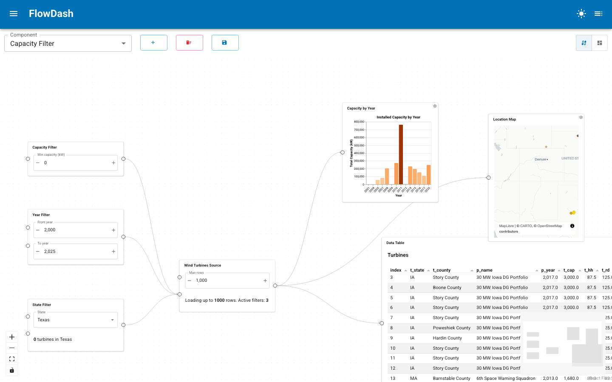

# Wire the Dataflow

The `DataflowGraph` engine manages node instances and edge connections. It
validates connections at wire-time (types, cycles, single-source) and catches
runtime errors via `param.watch`.

In the editor you build this graph visually: each component becomes a node whose
ports are the handles on its left (inputs) and right (outputs), and dragging
between handles creates an edge. The example below wires three sidebar filters
into a data source that feeds a table, a chart, and a map.



---

## Create a graph

```python
from panel_flowdash import DataflowGraph, build_component_specs

specs = build_component_specs(registry)
graph = DataflowGraph(specs)
```

The `on_error` callback is invoked whenever a runtime value propagation fails:

```python
def handle_error(source_id, source_port, target_id, target_port, exception):
    import panel as pn
    pn.state.notifications.error(
        f"Error: {source_port} -> {target_port}: {exception}"
    )

graph = DataflowGraph(specs, on_error=handle_error)
```

---

## Add nodes

Each node is an instance of a component. The instance ID is unique on the
dashboard; the component ID references the spec:

```python
graph.add_node("filter_1", "Analytics/filter")
graph.add_node("chart_1", "Analytics/chart")
```

This creates a `NodeState` parameterized instance with one param per port.

---

## Connect edges

```python
result = graph.add_edge("filter_1", "filtered", "chart_1", "data")
```

`add_edge` returns `True` on success, or an error message string on failure.
Use this for user-facing notifications:

```python
result = graph.add_edge(src_id, src_port, tgt_id, tgt_port)
if result is not True:
    pn.state.notifications.warning(result)
```

---

## Validation rules

The engine enforces these rules before creating a connection:

### Node and port existence

Both source and target nodes must exist, and the named ports must be present
on their respective node states.

### Single source per input

Each input port accepts at most one incoming connection. Attempting a second
connection returns:

> Input 'data' already has a connection. Disconnect it first.

### Cycle detection

The engine uses BFS to verify that adding the edge would not create a cycle.
Self-loops are rejected immediately.

### Type compatibility

If both the source output and target input have declared types, they must
match (case-insensitive). Untyped ports accept any connection.

---

## Runtime validation

After an edge is wired, value changes propagate via `param.watch`. If the
target raises an exception on assignment (e.g. a param validation error), the
`on_error` callback fires rather than crashing the application:

```python
errors = []

def collect_errors(*args):
    errors.append(args)

graph = DataflowGraph(specs, on_error=collect_errors)
graph.add_node("a", "comp_a")
graph.add_node("b", "comp_b")
graph.add_edge("a", "output", "b", "input")

# If setting b.input raises, on_error is called
state_a = graph.get_state("a")
state_a.output = "invalid_value"
```

---

## Carry failures downstream

By default an output that raises, or an edge transform that fails, is logged and
skipped. The connected input keeps its last value, so a downstream component
goes on showing data computed from a value that no longer holds, with nothing to
say so. For dashboards where stale data is worse than no data, switch on failure
propagation:

```python
from panel_flowdash import FlowDash, FlowDashApp

editor = FlowDash(components, propagate_failures=True)
app = FlowDashApp(project_dir="my_project", propagate_failures=True)
```

`DataflowGraph(specs, propagate_failures=True)` does the same for the engine on
its own. The setting is read when the editor or graph is constructed. The
failure is still logged once, where it happens, and the next successful value
replaces it.

A failure travels as a [`param.ReactiveError`](https://param.holoviz.org/user_guide/Reactive_Expressions.html)
value, Param's own channel for this, carrying the original exception. What an
input does with it depends on whether the component declared that it handles
failures.

### Inputs that do not handle failures

This is the default. The input keeps its last valid value, so a typed parameter
such as `param.String` is never handed an object it would reject. The failure is
recorded on the node, see `graph.get_failures(node_id).failed`, which maps the
input name to an `InputFailure` with the upstream `source_id`, `source_port`
and the `error`.

In the dashboard, in view and in edit mode, the component's tile is covered by a
message naming the upstream port and the exception, for example:

> Input 'ticker' is stale: 'inverse' of 'Inverse' failed (ZeroDivisionError: division by zero)

The message disappears when a valid value arrives. On the wiring canvas the node
and the failed edge are outlined in red, and the value popup of the input shows
the failure instead of the stale value.

A node with a failed input passes the failure on through all of its outputs for
as long as it lasts, because an output is derived from the inputs and cannot be
trusted while one of them is stale. A chain `A -> B -> C` therefore shows the
message on both `B` and `C` when `A` fails, and clears when `A` recovers.

### Inputs that handle failures

A component opts in per input with `handles_failures` in `@register`. That input
then receives the `param.ReactiveError` itself, and its tile shows no message
because the component is expected to present the failure in its own way:

```python
import param
import panel as pn
from panel_flowdash import register


@register(component=True, handles_failures=["data"])
class Table(pn.viewable.Viewer):
    data = param.Parameter()

    @param.depends("data")
    def __panel__(self):
        if isinstance(self.data, param.ReactiveError):
            return pn.pane.Alert(f"No data: {self.data.exception}", alert_type="danger")
        return pn.pane.DataFrame(self.data)
```

The parameter behind a handling input must accept a failure, so it must be an
untyped `param.Parameter`. Declaring a typed one, or naming an input the
component does not have, raises a `ValueError` when the component is loaded. For
a function component list the input in `requires` as well as in
`handles_failures`.

An output that depends on a handling input carries the failure on by itself:
Param does not call a bound function with a `ReactiveError` argument unless it
is told to, and returns the failure instead.

### List inputs

A list input fails as a whole. If any connected member fails, the input is
failed and keeps its last list; showing only the members that still work would
pass off a partial result as the full one. A list input that handles failures
receives a single `param.ReactiveError` in place of the list. When every member
is healthy again the list resumes.

### Validation

Connection validation and edge transforms skip failures instead of raising on
them: a failure is no value to type-check, and a transform step hands it on
untouched.

---

## Remove edges and nodes

```python
graph.remove_edge("filter_1", "filtered", "chart_1", "data")
```

Removing an edge unsubscribes the watcher and resets the target port to its
default value.

```python
graph.remove_node("filter_1")
```

Removing a node clears all connected edges automatically.

---

## Query state

```python
state = graph.get_state("filter_1")
current_value = state.filtered

all_edges = graph.edges
all_node_ids = graph.node_ids
```
