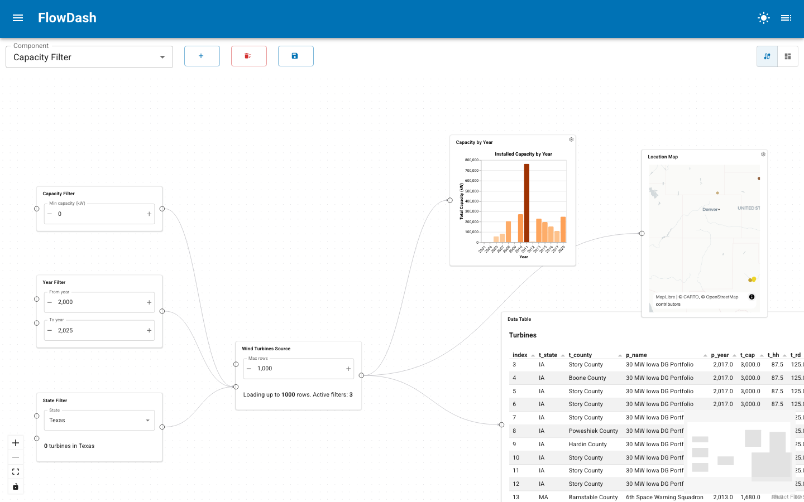

# Build Dataflow Dashboards in Python

**panel-flowdash is a framework for building visual, dataflow-driven dashboards
with Panel.** Define components with typed ports, wire them together, and persist
layouts to SQLite, JSON files or a store of your own.



!!! tip "Quick Demo"
    New to FlowDash? **[Try the quickstart &rarr;](quickstart.md)**

## Why FlowDash?

- **Component-first architecture**: define reusable building blocks with `@register` or as Viewer subclasses.
- **Typed dataflow**: ports carry type information for compile-time and runtime validation.
- **Visual wiring**: connect components in a node editor, with cycle detection and single-source enforcement.
- **Edge transforms**: reshape a value along a connection, picking a column, filtering rows or aggregating, without writing a component.
- **Persistence**: dashboard layouts, edges, and grid positions are stored in SQLite, as JSON files, in memory, or in a store you implement.
- **One command to serve**: `flowdash serve my_project/` scans, registers, and launches.
- **Or no command at all**: embed the `FlowDash` editor in an app you are already building.

## Quickstart

```python
from panel_flowdash import register

@register(component=True, page=False, provides=[{"key": "ticker", "type": "str"}])
def app(config):
    import panel_material_ui as pmui

    select = pmui.Select(label="Ticker", options=["AAPL", "GOOG", "MSFT"])
    config.ticker = select.param.value  # publish the selection on the `ticker` output
    return select
```

```bash
flowdash serve my_project/ --port 5006
```

## How-to guides

- [Register Components](how-to/register-components.md) - the `@register` decorator and Viewer classes
- [Define Ports](how-to/define-ports.md) - typed inputs and outputs for dataflow wiring
- [Configure Nodes](how-to/configure-nodes.md) - design-time configuration and custom editors
- [Wire the Dataflow](how-to/wire-dataflow.md) - connecting components with validation
- [Transform Edges](how-to/transform-edges.md) - reshaping values along a connection, and adding your own steps
- [Layout & Sizing](how-to/layout-and-sizing.md) - dashboard mode, sidebar components, and responsive tiles
- [Persist Dashboards](how-to/persist-dashboards.md) - SQLite, JSON folder and in-memory stores for layouts and edges
- [Dashboard Settings and Refresh](how-to/dashboard-settings.md) - dashboard-wide settings and the shared refresh signal
- [Serve a Project](how-to/serve-project.md) - the `flowdash serve` CLI
- [Embed the Editor](how-to/embed-the-editor.md) - using `FlowDash` programmatically, without the routing
- [Manage Permissions](how-to/manage-permissions.md) - authentication, sharing and who may administer a dashboard

## Examples

- [Examples gallery](examples/index.md)

## Reference

- [API reference](reference/panel_flowdash.md)
- [Release notes](releases.md)
